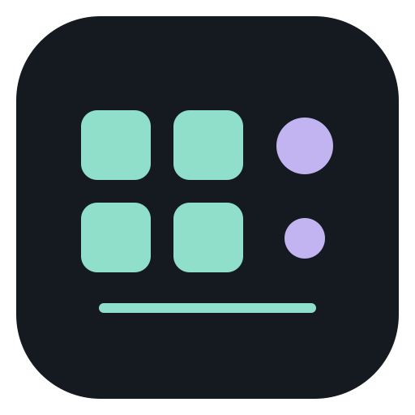
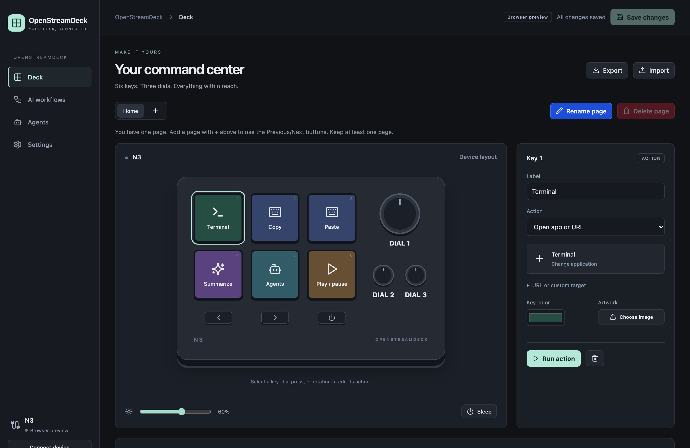
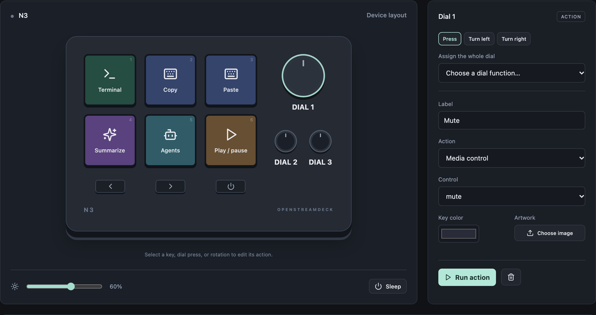
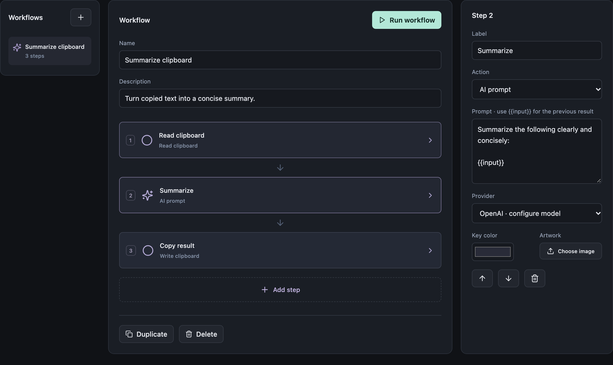
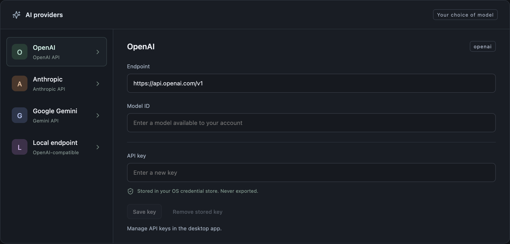
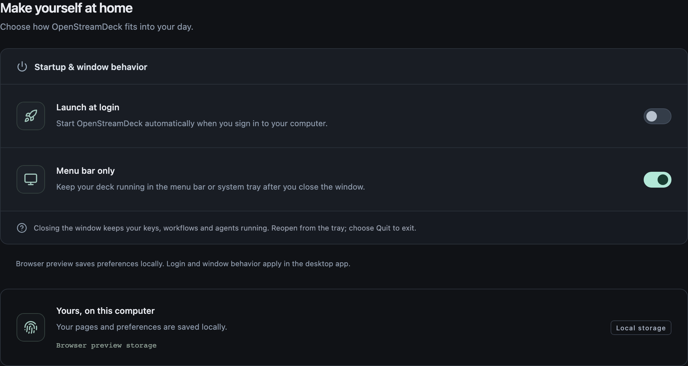

<p align="center">
  
</p>

<h1 align="center">OpenStreamDeck</h1>

<p align="center">
  <strong>Your apps. Your agents. One deck.</strong><br>
  Turn the N3 into a personal control surface for your desktop and AI workflows.<br>
  Six LCD keys. Three dials. Everything within reach.
</p>

<p align="center">
  <a href="https://github.com/DEKHTIARJonathan/OpenStreamDeck/actions/workflows/ci.yml"></a>
  <a href="LICENSE"></a>
  <a href="Cargo.toml"></a>
  <a href="src-tauri/Cargo.toml"></a>
  <a href="ROADMAP.md"></a>
</p>

<p align="center">
  <a href="#quick-start"></a>
  <a href="docs/USAGE.md"></a>
  <a href="ROADMAP.md"></a>
</p>

<p align="center">
  <a href="#the-tour">The tour</a> ·
  <a href="#what-can-you-put-on-a-key">Features</a> ·
  <a href="#your-agents-within-reach">Agents</a> ·
  <a href="#quick-start">Quick start</a> ·
  <a href="#contributing">Contributing</a>
</p>

<a href="docs/images/deck.webp"></a>

<p align="center">
  <sub>The real OpenStreamDeck browser UI, using the included example configuration. <a href="docs/images/README.md">Screenshot details</a>.</sub>
</p>

## Less reaching. More doing.

Launch your tools, control your music, run a workflow, or bring an agent session
forward—from the same deck. OpenStreamDeck is a **free, open-source N3
controller** built with Rust, Tauri 2 and React, targeting macOS, Windows and
Linux.

<table>
<tr>
<td width="33%" valign="top">
<h3>⌘ Your everyday shortcuts</h3>
<p>Apps, shortcuts, media and macros, exactly where your hands expect them.
Give each page a purpose and each key a recognizable face.</p>
</td>
<td width="33%" valign="top">
<h3>✦ Your repeatable workflows</h3>
<p>Connect clipboard or file inputs to a model and a next step.
Configure the sequence once, then put it on a key.</p>
</td>
<td width="33%" valign="top">
<h3>◎ Your local control center</h3>
<p>Keep configuration on your machine, credentials in the OS store,
and your choice of AI provider. Stay running from the tray.</p>
</td>
</tr>
</table>

## The tour

Click any image to explore it at full resolution.

<table>
<tr>
<td width="50%" valign="top">
<a href="docs/images/dials.webp"></a>
<h3>01 · Make every turn count</h3>
<p>Press, clockwise and counterclockwise bindings are independent.
Use whole-dial presets for quick setup, or tune each direction yourself.</p>
</td>
<td width="50%" valign="top">
<a href="docs/images/workflows.webp"></a>
<h3>02 · Put a workflow on a key</h3>
<p>Compose steps, pass results forward and stop on failure.
The included example turns copied text into a summary and copies it back.</p>
</td>
</tr>
<tr>
<td width="50%" valign="top">
<a href="docs/images/providers.webp"></a>
<h3>03 · Bring your model</h3>
<p>Choose OpenAI, Anthropic, Gemini or an OpenAI-compatible endpoint,
including a local server. Set the model you want to use.</p>
</td>
<td width="50%" valign="top">
<a href="docs/images/settings.webp"></a>
<h3>04 · Close the window. Keep the deck.</h3>
<p>Tray mode keeps controls and monitoring running after the editor closes.
Reopen when you need it, or choose Quit to stop the app.</p>
</td>
</tr>
</table>

These are captures of the running React UI with public example data, not
mockups. USB, OS actions and credential storage run in the desktop app; browser
screenshots do not establish native or physical-device validation.

## What can you put on a key?

|                            | Your controls                                                                                                                                                    |
| -------------------------- | ---------------------------------------------------------------------------------------------------------------------------------------------------------------- |
| **Apps & shortcuts**       | Pick an application with its native icon; open a URL; run a keyboard shortcut; type text; control media; click a mouse button                                    |
| **Artwork & pages**        | Colors, glyphs, labels and uploaded artwork; add, rename and delete pages; fixed Previous/Next buttons with wraparound; draft editing and explicit saves         |
| **Workflows & macros**     | Ordered actions, conditions, cycles, delays and cancellation; clipboard and text-file steps; configured shell commands                                           |
| **AI workflows**           | Explicit inputs, configurable models and endpoints, streaming provider transports and visible execution errors                                                   |
| **Local coding agents**    | Herdr sessions, Codex parent/child discovery and Claude Code lifecycle hooks; dashboard navigation, selection, focus and prompts where the adapter supports them |
| **Device & desktop**       | Automatic discovery/reconnect, brightness, sleep/wake, optional inactivity sleep, tray operation and launch-at-login settings                                    |
| **Portable configuration** | JSON import/export for pages, workflows and settings; validation and a previous-save backup; credentials excluded from exports                                   |

### One key. Three steps.

The included **Summarize clipboard** workflow is a starting point:

```text
    COPY SOME TEXT             PRESS YOUR KEY               PASTE THE RESULT
          │                          │                             ▲
          └──────► Read clipboard ──► AI summary ──► Copy result ────┘
```

Choose a provider and model in **Settings → Agents & AI**, store its API key in
the desktop app if needed, then assign **Run workflow** to a key. Edit the
prompt or add steps to make the workflow yours.

## Your agents, within reach

Open the **Agents** dashboard to see reported activity from your local coding
sessions. **Agent dashboard** brings OpenStreamDeck forward. **Focus** targets
the selected external session. **Show on deck** explicitly puts session status
on the LCD keys; **Return to keys** restores your page.

| Integration     | What is available today                                                                                                      |
| --------------- | ---------------------------------------------------------------------------------------------------------------------------- |
| **Herdr**       | Session discovery, pane targeting and supported host-terminal focus. Windows terminal activation remains unavailable.        |
| **Codex**       | Paginated live-thread discovery, distinct parent/child identities and macOS focus. Direct prompt routing is not implemented. |
| **Claude Code** | Lifecycle reporting through additive hooks. Hook setup is currently manual.                                                  |

Ready means a session is between turns—not that its task is complete.
[Set up your integrations →](docs/USAGE.md#agents)

## Made for the N3

**Six LCD keys · Three push dials · Two page buttons · One customizable button**

The supported device is the **N3, USB `5548:1001`**, vendor usage page `0xFFA0`,
usage `1`. Previous/Next always navigate pages; the third ordinary button is
yours to assign. Every dial has separate press, left and right bindings.

The desktop app renders both its native key preview and device JPEGs through one
Rust artwork renderer. It discovers the N3 at launch and retries after a
disconnect. Close the vendor controller before connecting OpenStreamDeck.

> [!NOTE] OpenStreamDeck is actively developed for macOS, Windows and Linux. OS,
> provider and physical-device coverage varies. The
> [verification matrix](docs/TEST-MATRIX.md) records what was tested and what
> still needs observation; the CI badge links to actual workflow results.

## Quick start

### Build and launch

Install Rust and Bun using the versions in
[rust-toolchain.toml](rust-toolchain.toml) and [.bun-version](.bun-version),
plus the
[native platform prerequisites](docs/CI.md#local-checks-and-pre-commit). The
project uses Bun for JavaScript dependencies.

```sh
git clone https://github.com/DEKHTIARJonathan/OpenStreamDeck.git
cd OpenStreamDeck
make setup          # Install the development tools, including the Tauri CLI
bun ci              # Install dependencies from bun.lock
cargo tauri dev     # Start the native app and its frontend
```

### Make your first key

1. **Connect the N3.** Close the vendor app first. OpenStreamDeck discovers the
   device automatically.
2. **Choose a key.** Select **Open app or URL**, then **Choose an application**.
   Its target, name and icon are set together.
3. **Save changes.** Try the key, then add a page, dial assignment or workflow.

Linux needs the included [udev rule](src-tauri/bundle/70-openstreamdeck.rules);
reconnect after installing it. macOS and Windows use the OS HID driver.

<details>
<summary><strong>Development, packaging and platform notes</strong></summary>

`cargo tauri dev` starts Vite automatically on port 1420. React changes reload;
Rust changes rebuild the app. Keep one development server running. For browser
editing and design preview only, use `bun run dev`.

```sh
bun run build       # Check TypeScript and build the frontend
cargo tauri build   # Build the native bundle for this platform
```

| Build target | Packaging      | Distribution notes                                                       |
| ------------ | -------------- | ------------------------------------------------------------------------ |
| **macOS**    | Universal DMG  | Ad-hoc signing; Developer ID signing and notarization are not configured |
| **Windows**  | MSI / NSIS     | Unsigned installers                                                      |
| **Linux**    | DEB / AppImage | DEB includes the udev rule; AppImage users install it separately         |

These are configured release targets. See the
[Releases page](https://github.com/DEKHTIARJonathan/OpenStreamDeck/releases) for
published artifacts and [CI and releases](docs/CI.md) for the packaging gates.
Start with the source build above.

</details>

## Local by design

- **Your configuration stays on your machine.** Export pages, workflows and
  settings as JSON; normal saves keep a previous-file backup.
- **Your keys stay in the OS credential store.** Provider identity and endpoint
  scope each credential. API keys are excluded from configuration exports.
- **Your inputs are explicit.** Clipboard and file reads are configured actions.
  AI steps send the configured input to the provider you choose.
- **Your commands stay configured.** Model output is never implicitly executed.
  Shell steps receive previous output as environment data.

<details>
<summary><strong>Under the hood</strong></summary>

```text
   React editor ─── typed Tauri IPC ──┐
                                     ▼
   N3 buttons & dials ───────► Rust action engine
                                     │
                 ┌───────────────────┼────────────────────┐
                 ▼                   ▼                    ▼
          Desktop actions      AI workflows        Local agents

   Native artwork renderer ──► Editor preview + N3 display frames
```

USB, processes, OS input, persistence and secrets stay in Rust. UI requests and
hardware triggers use the same action engine. A serialized device worker owns
HID writes; one renderer supplies native preview and device frames.

Read the [architecture guide](docs/ARCHITECTURE.md),
[N3 protocol](docs/PROTOCOL.md) and
[shell workflow boundary](AGENTS.md#shell-workflow-data-boundary).

</details>

## Contributing

Help make the deck dependable on more desks: improve an action, add a meaningful
regression, report an OS integration issue, or document a physical N3
observation. Start with [AGENTS.md](AGENTS.md) and the [roadmap](ROADMAP.md).

```sh
bunx --no-install playwright install chromium
make test           # Frontend, browser and Rust tests
prek run -a         # Formatting, lint and dependency checks
```

Automated tests use fixtures and local test services. They require no N3, agent
apps, API keys or OS input permissions. Physical controls and visible device
pixels need separate observation. See the
[hardware diagnostic guide](docs/TEST-MATRIX.md#manual-hardware-diagnostics)
before running manual checks.

| Keep exploring                             |                                                              |
| ------------------------------------------ | ------------------------------------------------------------ |
| [User guide](docs/USAGE.md)                | Configure pages, actions, workflows, agents and settings     |
| [Roadmap](ROADMAP.md)                      | Current capabilities, next priorities and product boundaries |
| [Verification matrix](docs/TEST-MATRIX.md) | Tests, measured observations and remaining gaps              |
| [CI & releases](docs/CI.md)                | Development prerequisites, checks and installer publication  |
| [Architecture](docs/ARCHITECTURE.md)       | Components, execution and trust boundaries                   |
| [Protocol](docs/PROTOCOL.md)               | N3 packets, image transfers and observed variants            |

---

<p align="center">
  <strong>Your desk, connected.</strong><br>
  Free and open source under <a href="LICENSE">GPL-3.0-or-later</a>.<br>
  <sub>Dependency and icon attribution: <a href="THIRD-PARTY-NOTICES.md">third-party notices</a>.</sub>
</p>
